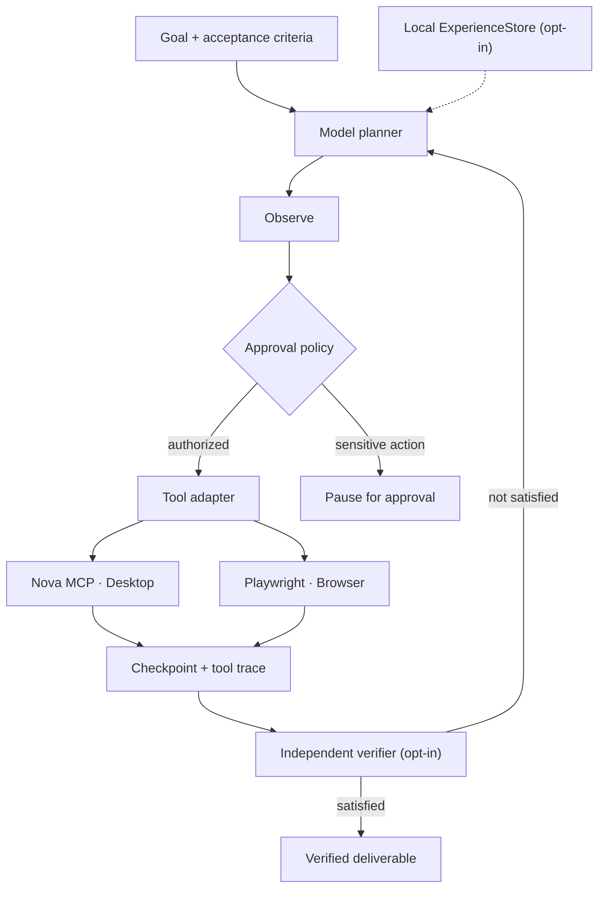

<div align="center">

# Praxis

**Goal-Driven Autonomous Agent Runtime**

**Plan. Act. Verify. Learn.**

[](https://github.com/xiangguangxin/Praxis/actions/workflows/ci.yml)
[](https://www.python.org/)
[](LICENSE)

[Demo & acceptance](docs/ACCEPTANCE.md) · [Quick start](#quick-start) · [Architecture](#architecture) · [Verification](#independent-verification) · [Experience](#experience-memory) · [Benchmarks](#benchmark--evaluation) · [中文](#中文介绍)

</div>

Praxis is a **goal-driven agent execution runtime** extracted from [OpenAS](https://github.com/xiangguangxin/OpenAS). It runs bounded observe → plan → act → verify loops against **Windows/macOS desktop tools (Nova MCP)** or an **isolated Chromium browser**, with resumable JSON checkpoints, approval gates, artifact verification, and opt-in experience retrieval.

> **Status:** Early-stage research and engineering runtime. Synthetic tests and opt-in browser fixtures are not proof of reliable real-world desktop autonomy. Praxis is not a daemon and does not run unattended in the background.

## Why Praxis?

| Principle | Current mechanism |
| --- | --- |
| **Plan** | Multimodal planner plus validated, mutable DAG orchestration with per-node acceptance checks |
| **Act** | Tool adapters for authorized Nova MCP desktops or Playwright browser sessions |
| **Verify** | Optional independent allowlisted file checks, provenance, freshness, and tool trajectory rules |
| **Learn** | Curated local experiences, environment-specific retrieval, confidence decay, manual feedback and invalidation |
| **Recover** | Durable checkpoint, process lock, manual reconciliation after uncertain actions |

## Quick start

Requires **Python 3.10+**, an authorized tool backend, and a separately configured multimodal model endpoint for live execution.

```bash
git clone https://github.com/xiangguangxin/Praxis.git
cd Praxis
python -m pip install -e .
praxis create ./goal-state.json --goal "Inspect an authorized app" --criterion "Expected output verified"
praxis status ./goal-state.json
praxis doctor
```

Set `PRAXIS_MODEL` and `PRAXIS_API_KEY` (or the backwards-compatible `OPENAS_GUI_MODEL` and `OPENAS_GUI_API_KEY`). For a Nova desktop session:

```bash
praxis run ./goal-state.json --nova /absolute/path/to/nova
praxis resume ./goal-state.json --nova /absolute/path/to/nova
```

The Nova executable must be installed and authorized separately. See [OpenAS Nova MCP integration](https://github.com/xiangguangxin/OpenAS/blob/main/plugins/openas/integrations/computer-use/USER-GUIDE.md).

For browser goals:

```bash
python -m pip install -e ".[browser]"
python -m playwright install chromium
praxis run ./goal-state.json --browser-url https://example.com/
```

Only test web apps you are authorized to automate. Browser execution uses an isolated, nonpersistent context and is not a security sandbox for hostile websites.

## Try a complete browser goal

```bash
python -m pip install -e ".[browser]"
python -m playwright install chromium
praxis doctor --browser
praxis demo --output ./demo-run
```

Open `demo-run/index.html` for the actual final screenshot, downloaded report and
independent verification results. This is a **real Chromium integration demo with
a deterministic fixture planner**, requiring no API key. It is not a real-model
success-rate claim. [Reproduce it or run live acceptance](docs/ACCEPTANCE.md).
See the [recorded validation and downloadable demo](docs/VALIDATION.md).

## Architecture



Completion records a `verification_level`: `model_evidence`,
`independent_artifact`, or `custom_verifier`. Legacy completed checkpoints without
provenance read as `legacy_unspecified`. The CLI exits with 0 for completed, 3 for
paused, 4 for blocked and 5 for failed execution.

The planner may assert completion; **without an independent verifier**, this is model-evidence compatibility mode rather than independently established success. If an action's outcome is uncertain after a crash, Praxis blocks replay until the operator reconciles it.

## Autonomous DAG orchestration (Phase 5)\n\nThe reusable `planning` package supports per-node dependencies, acceptance checks, independent verification evidence, bounded retries, checkpoint/resume, explicit interruption reconciliation, and safe replacement of unfinished work while preserving completed nodes. It also supports adding/removing pending nodes. See [Phase 5 orchestration guide](RUNTIME.md#phase-5-autonomous-dag-orchestration). This is currently a library-level primitive, not yet the default GUI `praxis run` executor.\n\n## Independent verification

Use a trusted verifier rules file, mapped to the checkpoint criteria:

```bash
praxis run ./goal-state.json --nova /absolute/path/to/nova --verifier ./rules.json
praxis verify ./goal-state.json --verifier ./rules.json
praxis reconcile ./goal-state.json --outcome executed --note "Independently checked the desktop"
```

The local file verifier supports safe root-constrained paths, minimum size, content checks, JSON fields, changed-artifact freshness and run IDs. It does **not** prove visual UI correctness by itself. See [verifier fixtures](examples/coverage-artifact-verifier.json) and the [full runtime guide](RUNTIME.md).

## Review and recovery

Advertised tool schemas are validated locally before dispatch; unknown tools or
invalid arguments never reach the backend. Remote schema references are not fetched.

Sensitive tool names, control targets and executable payloads trigger review even
when a planner labels them low impact. `praxis status` exposes a redacted
`pending_review` with its exact fingerprint and expiry. Review the actual target
before resuming with `--approve-pending --approval-id <fingerprint>`. A changed
observed view, action, policy or backend requires a new review. Keep passing the
same `--policy` and `--verifier` on resume.

Trusted operator policies support exact argument matches with `allow`, `approve`
and `deny` effects. See [policy example](examples/action-policy.json) and
[approval and recovery details](RUNTIME.md#reviewable-approval-and-action-policy).
Policies aid authorization; they are not a security sandbox and cannot infer all
UI effects. `praxis retry` reopens known-outcome failures; uncertain in-flight
actions still require `praxis reconcile`. Ctrl+C persists a paused or blocked state;
backend bindings are checked before a new session starts.

## Experience memory

Successful runs can become **curated** experiences only after trusted file verification, with operator-provided notes. Prior experiences are *untrusted planning hints* and are **never automatically replayed**.

```bash
praxis-experience --store ./experiences.json add ./goal-state.json \
  --verifier ./rules.json --environment win11-app-v1 \
  --note "Output inspected"
praxis run ./goal-state.json --nova /absolute/path/to/nova \
  --experience-store ./experiences.json --experience-environment win11-app-v1
```

Matching uses simple lexical overlap and exact environment tags, not embeddings. Default confidence half-life: 30 days; retention eligibility: 90 days; two explicitly recorded verified failures invalidate an experience. Experience writes use a process lock. The store is neither encrypted nor
access-controlled. Curated entries can include preconditions, key steps, failure
modes and independent verification references; these remain untrusted planning hints.

## Benchmark & evaluation

```bash
praxis-benchmark examples/benchmark-suite.json
python -m unittest discover -s tests -v
python scripts/check_runtime_mutations.py
```

Offline fixtures are synthetic and must not be presented as real desktop success rates. Live Nova and browser benchmarks require real backends and independent acceptance checks; see [benchmark guide](RUNTIME.md#agent-benchmark).

## Extended runtime primitives\n\nPraxis also provides opt-in building blocks for model-proposed DAG validation (DynamicTaskPlanner), deterministic context packing, capability-aware model profile selection, a durable local SQLite job queue, and an allowlisted operational event journal. These are composable library APIs; they do not automatically launch background workers or change the existing CLI agent loop. See [Phases 1–4 implementation status](docs/phases-1-to-4.md).\n\n## Boundaries and roadmap

**Included now:** bounded agent loop, Nova/browser adapters, model gateway selection, restart-based resume and reconciliation, approval policy, local artifact verification, trace comparison, experience lifecycle, offline/live evaluation harnesses.

**Not guaranteed:** continuous background execution, remote distributed scheduling, zero-configuration providers, general-purpose sandboxing, unsupervised experience learning, real Windows/macOS E2E reliability, or permissionless tool access.

**Validation:** CI runs Linux/Windows/macOS unit checks and real Chromium
integration with a scripted model. A separate manual workflow supports real-model
browser acceptance and configured Nova desktop runners. See the
[acceptance guide](docs/ACCEPTANCE.md). General desktop reliability still requires
measured native application trials. API compatibility is not yet frozen.

The project was extracted from [OpenAS](https://github.com/xiangguangxin/OpenAS). See [migration and compatibility notes](MIGRATION.md), [detailed documentation](RUNTIME.md) and the [MIT license](LICENSE).

---

<a id="中文介绍"></a>

## 中文介绍

**Praxis — 目标驱动的自主 Agent Runtime**，以 **规划 → 行动 → 验证 → 经验复用** 为核心闭环。

Praxis 从 OpenAS 的 GUI Agent Runtime 独立而来，目前支持 **Nova MCP 桌面操作**与 **Playwright 浏览器操作**，提供 checkpoint 恢复、敏感操作审批、可选的独立文件验收、Benchmark 及经验检索与失效机制。**模拟测试不代表真实桌面端到端验证通过**，经验提示也不会直接变成自动执行命令。

使用 `pip install -e .` 安装，运行 `praxis --help`，完整参数参考 [RUNTIME.md](RUNTIME.md)。OpenAS 继续维护 Agents & Skills，与 Praxis 以工具集成形式协作。

## Integrated planning, verified task execution, model routing and scheduled jobs

The GUI execution loop can call `ModelPlanner.prepare_plan()` before its first action and checkpoint the task DAG. With an independent `--verifier` configuration and task acceptance entries mapped exactly to Goal criteria, Praxis activates tasks in dependency order and independently verifies each `task_complete` request. Failed checks retry within a bounded budget; exhausted failures block dependents. Task progress and per-task fresh-artifact baselines are stored in the Goal checkpoint. Plans without an independent verifier or valid acceptance mapping remain advisory. Every GUI action still uses fresh observation, schema validation, operator policy and approval gates.

Optional model routing uses a JSON profile file:

```json
{
  "default": "economy",
  "profiles": [
    {"name":"economy","model":"small-model","endpoint":"https://provider.example/v1/chat/completions","api_key_env":"SMALL_MODEL_KEY","capabilities":["chat"],"max_cost_tier":1},
    {"name":"vision","model":"vision-model","endpoint":"https://provider.example/v1/chat/completions","api_key_env":"VISION_MODEL_KEY","capabilities":["chat","vision"],"max_cost_tier":3}
  ]
}
```

Use `--model-profiles ./models.json` with `praxis run` or `resume`. The router selects a vision-capable profile when screenshots are present and prefers a higher cost tier after failed actions. Set each profile's API key environment variable before running. Routing never bypasses action approvals.

Queue a goal for a bounded local worker:

```bash
praxis schedule --database ./praxis-jobs.sqlite --goal "Inspect the report" --criterion "Report was verified"
praxis worker --database ./praxis-jobs.sqlite --checkpoint-dir ./job-checkpoints --max-jobs 1 --nova /path/to/nova --model-profiles ./models.json
```

The worker exits after at most `--max-jobs`, stores a checkpoint per job, and marks only an agent result with status `completed` as a completed job. Each claimed job has a renewable lease and fencing token; a heartbeat thread renews long-running work, expired leases are recovered after process crashes, and stale workers cannot publish a result after a new worker reclaims the job. Paused or blocked goals become failed queue entries for operator follow-up; explicit retry resets the attempt budget. This is a foreground local worker backed by SQLite, not a remote distributed scheduler.

The library-level DAG orchestrator can run independent task callbacks concurrently with `max_workers`, serialize tasks that share declared resource names, and aggregate per-task results and verification evidence. The integrated GUI runtime remains serial for one shared desktop session. See the Phase 5.4 guide in [RUNTIME.md](RUNTIME.md#parallel-task-execution-and-resource-locks-phase-54).
