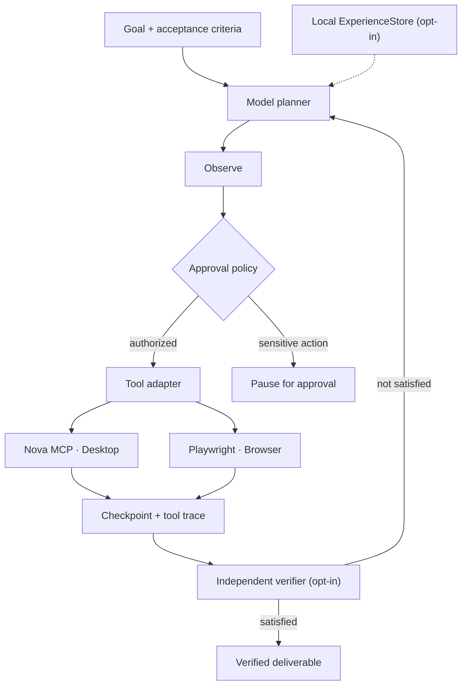

<div align="center">

# Praxis

**Goal-Driven Autonomous Agent Runtime**

**Plan. Act. Verify. Learn.**

[](https://github.com/xiangguangxin/Praxis/actions/workflows/ci.yml)
[](https://www.python.org/)
[](LICENSE)

[Quick start](#quick-start) · [Architecture](#architecture) · [Verification](#independent-verification) · [Experience](#experience-memory) · [Benchmarks](#benchmark--evaluation) · [中文](#中文介绍)

</div>

Praxis is a **goal-driven agent execution runtime** extracted from [OpenAS](https://github.com/xiangguangxin/OpenAS). It runs bounded observe → plan → act → verify loops against **Windows/macOS desktop tools (Nova MCP)** or an **isolated Chromium browser**, with resumable JSON checkpoints, approval gates, artifact verification, and opt-in experience retrieval.

> **Status:** Early-stage research and engineering runtime. Synthetic tests and opt-in browser fixtures are not proof of reliable real-world desktop autonomy. Praxis is not a daemon and does not run unattended in the background.

## Why Praxis?

| Principle | Current mechanism |
| --- | --- |
| **Plan** | Multimodal, OpenAI-compatible model planner with context and token/call budgets |
| **Act** | Tool adapters for authorized Nova MCP desktops or Playwright browser sessions |
| **Verify** | Optional independent allowlisted file checks, provenance, freshness, and tool trajectory rules |
| **Learn** | Curated local experiences, environment-specific retrieval, confidence decay, manual feedback and invalidation |
| **Recover** | Durable checkpoint, process lock, manual reconciliation after uncertain actions |

## Quick start

Requires **Python 3.10+**, an authorized tool backend, and a separately configured multimodal model endpoint for live execution.

```bash
git clone https://github.com/xiangguangxin/Praxis.git
cd Praxis
python -m pip install -e .
praxis create ./goal-state.json --goal "Inspect an authorized app" --criterion "Expected output verified"
praxis status ./goal-state.json
```

Set `PRAXIS_MODEL` and `PRAXIS_API_KEY` (or the backwards-compatible `OPENAS_GUI_MODEL` and `OPENAS_GUI_API_KEY`). For a Nova desktop session:

```bash
praxis run ./goal-state.json --nova /absolute/path/to/nova
praxis resume ./goal-state.json --nova /absolute/path/to/nova
```

The Nova executable must be installed and authorized separately. See [OpenAS Nova MCP integration](https://github.com/xiangguangxin/OpenAS/blob/main/plugins/openas/integrations/computer-use/USER-GUIDE.md).

For browser goals:

```bash
python -m pip install -e ".[browser]"
python -m playwright install chromium
praxis run ./goal-state.json --browser-url https://example.com/
```

Only test web apps you are authorized to automate. Browser execution uses an isolated, nonpersistent context and is not a security sandbox for hostile websites.

## Architecture



The planner may assert completion; **without an independent verifier**, this is model-evidence compatibility mode rather than independently established success. If an action's outcome is uncertain after a crash, Praxis blocks replay until the operator reconciles it.

## Independent verification

Use a trusted verifier rules file, mapped to the checkpoint criteria:

```bash
praxis run ./goal-state.json --nova /absolute/path/to/nova --verifier ./rules.json
praxis verify ./goal-state.json --verifier ./rules.json
praxis reconcile ./goal-state.json --outcome executed --note "Independently checked the desktop"
```

The local file verifier supports safe root-constrained paths, minimum size, content checks, JSON fields, changed-artifact freshness and run IDs. It does **not** prove visual UI correctness by itself. See [verifier fixtures](examples/coverage-artifact-verifier.json) and the [full runtime guide](RUNTIME.md).

## Experience memory

Successful runs can become **curated** experiences only after trusted file verification, with operator-provided notes. Prior experiences are *untrusted planning hints* and are **never automatically replayed**.

```bash
praxis-experience --store ./experiences.json add ./goal-state.json \
  --verifier ./rules.json --environment win11-app-v1 \
  --note "Output inspected"
praxis run ./goal-state.json --nova /absolute/path/to/nova \
  --experience-store ./experiences.json --experience-environment win11-app-v1
```

Matching uses simple lexical overlap and exact environment tags, not embeddings. Default confidence half-life: 30 days; retention eligibility: 90 days; two explicitly recorded verified failures invalidate an experience. The JSON store is **single-writer** and neither encrypted nor access-controlled.

## Benchmark & evaluation

```bash
praxis-benchmark examples/benchmark-suite.json
python -m unittest discover -s tests -v
python scripts/check_runtime_mutations.py
```

Offline fixtures are synthetic and must not be presented as real desktop success rates. Live Nova and browser benchmarks require real backends and independent acceptance checks; see [benchmark guide](RUNTIME.md#agent-benchmark).

## Extended runtime primitives\n\nPraxis also provides opt-in building blocks for model-proposed DAG validation (DynamicTaskPlanner), deterministic context packing, capability-aware model profile selection, a durable local SQLite job queue, and an allowlisted operational event journal. These are composable library APIs; they do not automatically launch background workers or change the existing CLI agent loop. See [Phases 1–4 implementation status](docs/phases-1-to-4.md).\n\n## Boundaries and roadmap

**Included now:** bounded agent loop, Nova/browser adapters, model gateway selection, restart-based resume and reconciliation, approval policy, local artifact verification, trace comparison, experience lifecycle, offline/live evaluation harnesses.

**Not guaranteed:** continuous background execution, remote distributed scheduling, zero-configuration providers, general-purpose sandboxing, unsupervised experience learning, real Windows/macOS E2E reliability, or permissionless tool access.

**Next:** independent CI, reproducible live desktop acceptance, richer verified observation, and adapter contracts for future CLI/tool environments. API compatibility is not yet frozen.

The project was extracted from [OpenAS](https://github.com/xiangguangxin/OpenAS). See [migration and compatibility notes](MIGRATION.md), [detailed documentation](RUNTIME.md) and the [MIT license](LICENSE).

---

<a id="中文介绍"></a>

## 中文介绍

**Praxis — 目标驱动的自主 Agent Runtime**，以 **规划 → 行动 → 验证 → 经验复用** 为核心闭环。

Praxis 从 OpenAS 的 GUI Agent Runtime 独立而来，目前支持 **Nova MCP 桌面操作**与 **Playwright 浏览器操作**，提供 checkpoint 恢复、敏感操作审批、可选的独立文件验收、Benchmark 及经验检索与失效机制。**模拟测试不代表真实桌面端到端验证通过**，经验提示也不会直接变成自动执行命令。

使用 `pip install -e .` 安装，运行 `praxis --help`，完整参数参考 [RUNTIME.md](RUNTIME.md)。OpenAS 继续维护 Agents & Skills，与 Praxis 以工具集成形式协作。
